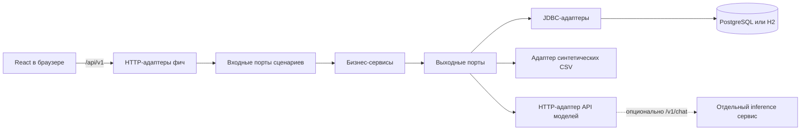
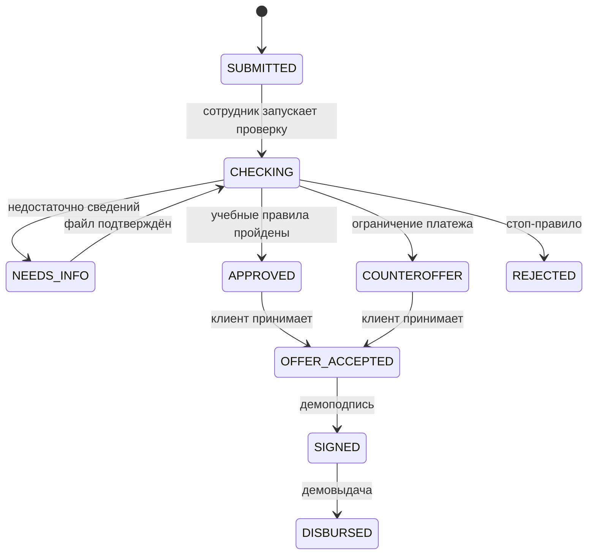

# Архитектура и состояния



Backend владеет денежными расчётами, переходами статусов, правами и сохранением данных. React отображает серверные ответы и отправляет подтверждённые действия. Сервис моделей получает контекст и сообщение, возвращает предлагаемую структуру, не изменяя БД напрямую. Провайдер и его настройки находятся в `inference/`; этот сервис не включён в Compose.

Структура Java-пакетов:

```text
org.alfahack
├── CreditCabinetApplication       # точка входа
├── core
│   ├── domain                    # User, Session, Profile, Product, UploadedDocument
│   ├── errors                    # ошибки приложения без HTTP-статусов
│   ├── transaction                # интерфейс UnitOfWork
│   ├── serialization              # интерфейс JsonCodec
│   ├── adapter/in/web             # отображение ошибок в HTTP
│   ├── adapter/out/persistence    # преобразование JDBC-типов
│   ├── adapter/out/serialization  # Jackson-адаптер
│   ├── adapter/out/transaction    # Spring-адаптер транзакций
│   └── config                    # FeatureConfiguration, SeedData
└── features
    ├── auth
    ├── products
    ├── drafts
    ├── applications
    ├── documents
    ├── forecast
    ├── insights
    ├── scoring
    └── assistant
```

У фичи `port/` определяет входные интерфейсы сценариев и выходные интерфейсы хранения/интеграций, `application/` реализует сценарии, `adapter/out/persistence/jdbc/` содержит SQL, `adapter/in/web/` преобразует HTTP-запросы и вызывает входные порты. Папки создаются по необходимости: у расчёта продуктов нет репозитория БД, у аналитики нет записей в БД. У скоринга синтетические данные и mock-источники реализуют `ProfileCatalog` и `RiskSources` в `adapter/out/memory/`. У помощника выходной порт `LanguageModel` и адаптер `adapter/out/http/`.

Например, фича документов:

```text
features/documents/
├── port/
│   ├── DocumentUseCases.java
│   ├── DocumentsRepository.java
│   └── DocumentContent.java
├── application/Documents.java
└── adapter/
    ├── in/web/DocumentsController.java
    └── out/
        ├── persistence/jdbc/JdbcDocumentsRepository.java
        └── resource/SeedDocumentContent.java
```

Зависимости направлены к интерфейсам: HTTP → входной порт ← сервис → выходной порт ← JDBC/HTTP/ресурсный адаптер. Другие фичи также вызываются через входные порты. Для нового транспорта нужно реализовать адаптер, вызывающий тот же порт; сервисы не принимают servlet-объекты или `MultipartFile`. Они не импортируют Spring, JDBC, Jackson или сетевые классы. Ошибки классифицируются через `DomainException.Kind`; HTTP-статусы выбирает только HTTP-адаптер.

`FeatureConfiguration` связывает интерфейсы с реализациями. `UnitOfWork` сохраняет прежние границы транзакций подачи, проверок, обновления черновика, документов, принятия предложения, подписи и выдачи; вложенные сценарии используют одну транзакцию. SQL, схема таблиц, optimistic locking, ключи идемпотентности и URL `/api/v1` сохранены. JDBC-даты преобразуются в `LocalDate` внутри адаптера. Существующие динамические проекции `Map<String,Object>` сохранены для совместимости API; общие значения вынесены в доменные records.

HTTP-авторизация обрабатывает cookie и CSRF в `HttpAuth`; проверку учётных данных, сессий и ролей выполняют сервис авторизации и доменная модель пользователя. Для другого транспорта вызывается `AuthUseCases.authenticate` со своим способом передачи токена.

`ArchitectureTest` проверяет направление зависимостей, `AssistantIntegrationTest` проверяет generic API моделей с локальным HTTP-стабом без реальной модели, `ScoringEngineTest` проверяет правила. `scripts/smoke.py` из корня прогоняет основной API-сценарий.



Главные сущности: `companies`, `demo_accounts`, `account_credentials`, `sessions`, `drafts`, `quotes`, `applications`, `scoring_reports`, `info_requests`, `documents`, `loans`, `ledger_events`, `application_events`, `idempotency_records`, `assistant_proposals`. `quotes` сохраняет исходный расчёт, а `applications` — снимок запроса. `scoring_reports` хранит объяснимый результат пяти метрик. Журнал `application_events` фиксирует переходы. Семь отраслевых профилей создаются `SyntheticProfiles`, источники заменены `MockSources`; схема, пороги и JSON-примеры описаны в [credit-policy.md](credit-policy.md).
