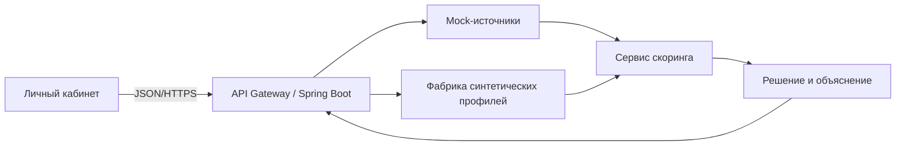

# Синтетический скоринг МСП

Это проектная модель для локального сценария. Она не повторяет банковский регламент, не использует реальные сведения о людях и компаниях и не вызывает внешние сервисы. Поля `founders` содержат только количество учредителей; имён, паспортов, ИНН и иных идентификаторов нет.

## Компоненты и поток данных



`SyntheticProfiles` создаёт отдельный устойчивый профиль STABLE и семь постоянных отраслевых кейсов: розница, производство, IT-услуги, общепит, логистика, сельское хозяйство и стройка. Профили отличаются месячной выручкой и её прошлым значением, прибылью, платежами по долгам, оборотными активами и обязательствами, оценкой залога, стажем, числом учредителей и просрочкой. Ключ кейса определяет данные однозначно. Новых персональных записей при каждом запуске нет.

`MockSources` предоставляет четыре независимых логических ответа: `credit_history`, `turnover`, `collateral`, `sme_registry`. Вход: ключ профиля (`RETAIL`, `MANUFACTURING`, `IT`, `CAFE`, `LOGISTICS`, `AGRICULTURE`, `CONSTRUCTION`). Ответ: JSON с `status: OK`, объектами источников и их полями. Источники не делают HTTP-запросов. Сценарий `MISSING_INFO` выдаёт `turnover.status: ERROR`, `code: DATA_MISSING`, `retryable: false`; `MOCK_FAILURE` выдаёт `status: ERROR`, `code: SOURCE_UNAVAILABLE`, `retryable: true`. `PRIORITY_CONFLICT` — производственный кейс с льготой и просрочкой, позволяющий проверить приоритет стоп-правила. Эти дополнительные ключи не входят в семь отраслевых профилей. Неизвестный ключ: HTTP 422 `UNKNOWN_PROFILE`. Коды являются внутренним контрактом, не именами ошибок реальных реестров.

`ScoringEngine` рассчитывает пять метрик. Все доли считаются по месячным синтетическим данным, DTI включает платёж по новой заявке, LTV считается только при наличии залога. `N/A` по LTV приносит 8 баллов вместо 15. Пороговые значения и веса:

| Метрика | Вес | Полный балл | Средний балл | 0 баллов |
| --- | ---: | --- | --- | --- |
| DTI | 30 | ≤25% | ≤40%: 18 | >40% |
| LTV | 15 | ≤70% | ≤90%: 9; без залога: 8 | >90% |
| Текущая ликвидность | 20 | ≥1,5 | ≥1,0: 12 | <1,0 |
| Рентабельность | 20 | ≥15% | ≥8%: 12 | <8% |
| Рост выручки | 15 | ≥10% | ≥0%: 9 | <0% |

Для производства, IT и сельского хозяйства при статусе МСП и стаже строго больше 12 месяцев риск получает коэффициент `0.90`; к баллу добавляется 5, итог ограничен 100. Льгота не отменяет стоп-правило: просрочка ≥30 дней, балл <45 или одновременные DTI >55% и ликвидность <1 приводят к отказу. При балле <75, DTI >40% или отсутствии залога для суммы свыше 1 млн ₽ решение условное. Иначе — одобрение. Дополнительно сервер проверяет свободный месячный поток и план возврата краткосрочного лимита. При ограничении платежа предлагает меньшую сумму, если она укладывается в диапазон продукта; иначе отказывает.

## API и ответы

Вход: `POST /api/v1/auth/sessions` с `{"login":"stable","password":"Alfa2026!"}`. Пароли тестовых учётных записей хранятся как PBKDF2-хэши с индивидуальной солью. Для изменяющих запросов после входа нужен `X-CSRF-Token`. `GET /api/v1/synthetic/profiles` доступен сотруднику и возвращает каталог кейсов. Клиентские `GET /api/v1/insights` и `GET /api/v1/cashflow/summary` возвращают идеи и историю на синтетических данных. Подача автоматически запускает проверки. Финансовый набор определяется компанией на сервере: STABLE → STABLE, GAP → MANUFACTURING, REJECT → CONSTRUCTION, MISSING → MISSING_INFO, COUNTER → CAFE. Сотрудник может повторить незавершённую проверку через `POST /api/v1/applications/{id}/checks` с `{}`; чужой demo_profile отклоняется с PROFILE_LOCKED. Завершённое решение возвращается без пересчёта.

Обороты и прибыль вычисляются CompanyProfiles из тех же сохранённых transactions, которые показаны в кабинете; текущие платежи включают existing_loans и loans. Балансовые показатели и залог — известные синтетические снимки. При отсутствии двух месяцев истории показатели не подменяются успешным профилем: запрашиваются сведения. Результат оценки сохраняется вместе с заявкой, включая исходные значения, формулы, источники, свободный поток, лимит платежа, дату и стоп-факторы. В `decision_report` есть `outcome`, `code`, `explanation`, `score`, `adjusted_score`, `subsidy_applied`, `risk_coefficient`, пять метрик и четыре mock-ответа. Клиент видит объяснение, сотрудник также видит баллы и входные mock-ответы. Примеры:

```json
{"status":"APPROVED","decision_report":{"outcome":"APPROVED","code":"POLICY_PASSED","explanation":"Денежный поток и ликвидность позволяют обслуживать выбранный платёж."}}
```

```json
{"status":"COUNTEROFFER","reason_code":"RISK_LIMIT","decision_report":{"outcome":"CONDITIONAL","code":"RISK_LIMIT","explanation":"Финансирование возможно при меньшей сумме или дополнительном обеспечении: нагрузка близка к порогу."}}
```

```json
{"status":"REJECTED","decision_report":{"outcome":"REJECTED","code":"CURRENT_OVERDUE_30_DAYS","explanation":"Высокая долговая нагрузка, слабая ликвидность или просрочка повышают риск невозврата. Льгота не отменяет ограничение по риску."}}
```

Недостаточно данных: заявка переходит в `NEEDS_INFO`, создаётся запрос выписки, HTTP 200. Пример: `{"status":"NEEDS_INFO","reason_code":"UNKNOWN_DEBT","requests":[{"document_type":"FINANCIAL_STATEMENT","status":"OPEN"}]}`. После подтверждения подготовленной синтетической CSV-выписки проверка продолжается. Другие файлы отклоняются с HTTP 422 `SYNTHETIC_ONLY` без сохранения. Ошибка mock-сервиса: заявка остаётся в `CHECKING`, `decision_report.outcome` равен `SOURCE_ERROR`, `code` равен `SOURCE_UNAVAILABLE`, повторный запуск допустим (для неизменного сценария результат предсказуемо повторится). Конфликт льготы и высокого риска разрешается в пользу стоп-правила: `REJECTED` с объяснением. Ошибки неверного тела возвращают HTTP 422, конфликты версии/состояния — 409, отсутствие сессии — 401, чужая заявка — 404.

Возможности на первом экране — внутренние сценарии, а не новости о реальной цене сырья. Модель в принятии кредитного решения не участвует. Адаптер `/assistant/messages` можно подключить через `MODEL_API_URL` позднее для формулировки текста; серверные правила, баллы и денежные расчёты останутся единственным источником решения. Провайдер модели изолирован в отдельном сервисе `inference/`.
