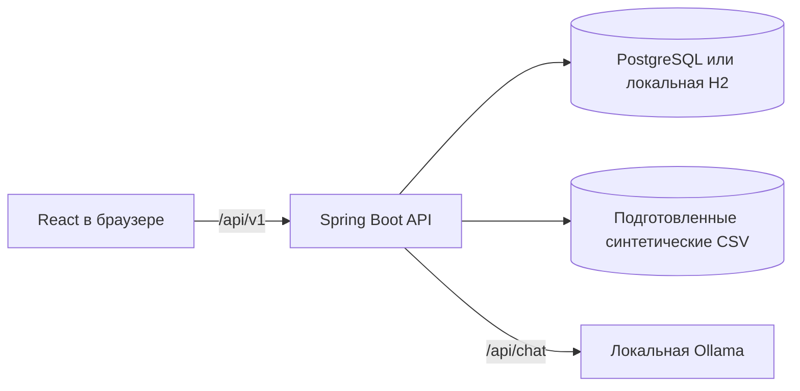
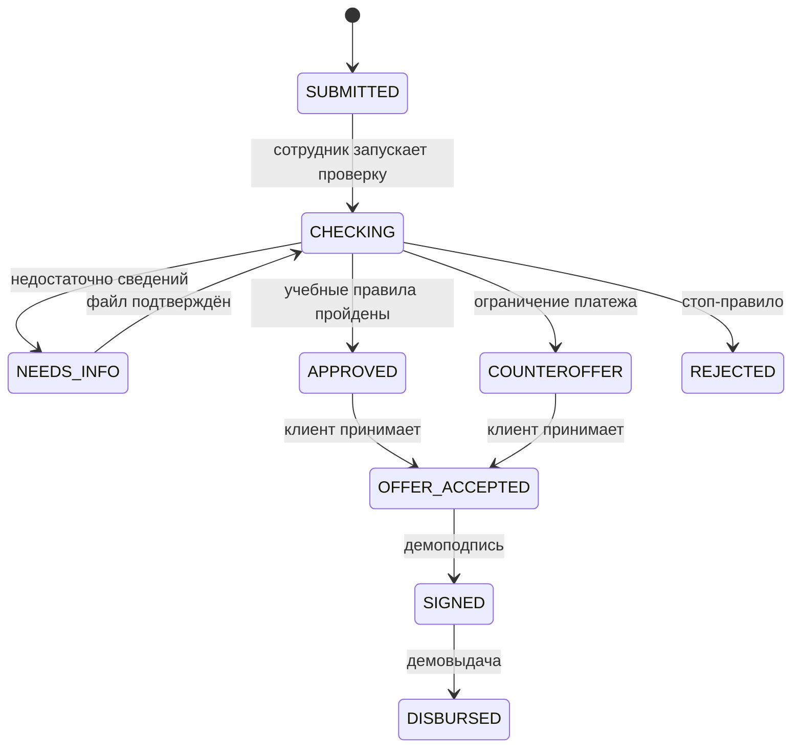

# Архитектура и состояния

Backend владеет денежными расчётами, переходами статусов, правами и сохранением данных. React отображает серверные ответы и отправляет подтверждённые действия. Ollama получает текущие параметры черновика и сообщение, возвращает предлагаемую структуру, не изменяя БД напрямую.

Главные сущности: `companies`, `demo_accounts`, `account_credentials`, `sessions`, `drafts`, `quotes`, `applications`, `scoring_reports`, `info_requests`, `documents`, `loans`, `ledger_events`, `application_events`, `idempotency_records`, `assistant_proposals`. `quotes` сохраняет исходный расчёт, а `applications` — снимок запроса. `scoring_reports` хранит объяснимый результат пяти метрик. Журнал `application_events` фиксирует переходы. Семь отраслевых профилей создаются `SyntheticProfiles`, источники заменены `MockSources`; схема, пороги и JSON-примеры описаны в [credit-policy.md](credit-policy.md).
